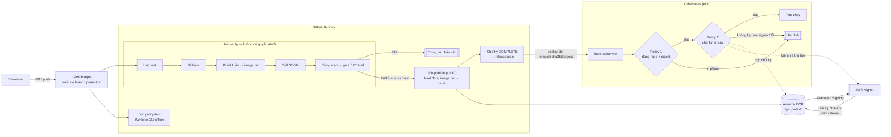
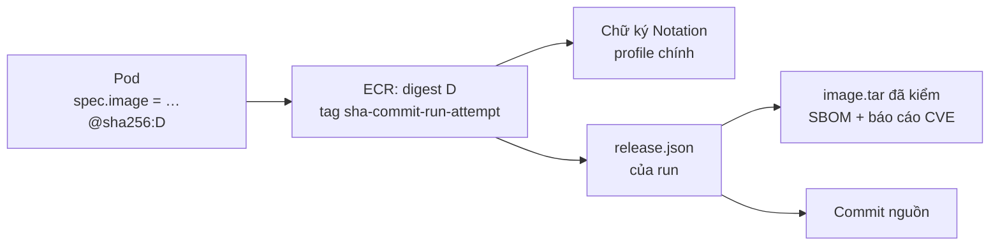

# Chương 3. Phân tích và thiết kế (bản nháp)

> Bản nháp theo dàn ý `KE_HOACH_DO_AN_FINAL.md` mục 15. Chương này trình bày **vì sao** hệ thống được thiết kế như vậy; cách cài đặt nằm ở Chương 4, kết quả kiểm chứng ở Chương 5. Nguồn: kế hoạch mục 1–2, 8.4, 9, 11, 12 và `docs/architecture.md`. Trước khi nộp: xuất sơ đồ Mermaid (Hình 3.1, 3.2) thành ảnh.

## 3.1. Phân tích bài toán

### 3.1.1. Mô hình mối đe dọa

Đề tài giới hạn mô hình mối đe dọa ở **bốn tình huống** trong đề cương. Mỗi tình huống ứng với một mắt xích của chuỗi cung ứng mà Chương 2 đã phân tích:

| Mã | Tình huống | Tác nhân / nguyên nhân điển hình | Mắt xích bị ảnh hưởng | Hậu quả nếu không chặn |
|---|---|---|---|---|
| T1 | Secret lọt vào mã nguồn | Lập trình viên vô ý commit khóa, token | Mã nguồn | Secret bị lộ vĩnh viễn trong lịch sử Git; kẻ tấn công dùng để truy cập hệ thống |
| T2 | Image chứa lỗ hổng Critical | Base image hoặc dependency cũ | Dependency, image | Workload có lỗ hổng đã biết, dễ bị khai thác |
| T3 | Image chưa ký, hoặc ký bởi danh tính không tin cậy | Image push tay, bỏ qua pipeline; registry bị chèn image | Registry, triển khai | Chạy mã không đi qua kiểm soát nào |
| T4 | Image từ nguồn không được phép | `kubectl run --image=docker.io/…`, dùng tag thay digest | Triển khai | Chạy image không rõ nguồn gốc; tag có thể bị trỏ sang nội dung khác |

Ngoài bốn tình huống trên, thiết kế còn phải chống lại các **đường vòng** có thể vô hiệu hóa kiểm soát: giấu image trong init container, dùng chữ ký của một profile khác, làm verifier ngừng hoạt động để được "cho qua", và người triển khai dùng quyền để vào container hay sửa policy. Đây là cơ sở của các ca mở rộng TC06–TC10.

Yêu cầu thứ năm là **truy vết**: từ một Pod đang chạy phải lần ngược được tới digest, SBOM, báo cáo lỗ hổng và commit nguồn. Khi có CVE mới hay sự cố, đây là điều kiện để trả lời câu hỏi "image nào chứa thành phần này, ai phát hành, từ mã nào".

### 3.1.2. Phạm vi

- **Bắt buộc:** một ứng dụng, một kiến trúc image (`linux/amd64`), một account AWS, một region, một namespace ứng dụng.
- **Không thuộc phạm vi:** bảo mật lúc chạy (runtime), quét mã nguồn tĩnh (SAST), ký hay kiểm attestation cho SBOM, chứng nhận SLSA.
- **Phạm vi kết luận:** đồ án kiểm soát *một số* rủi ro chuỗi cung ứng trong môi trường thực nghiệm. Đồ án không kết luận "image có chữ ký là an toàn" hay "chặn được mọi tấn công".

## 3.2. Yêu cầu

### 3.2.1. Yêu cầu chức năng

| Mã | Yêu cầu | Tiêu chí nghiệm thu |
|---|---|---|
| KQ1 | Container hóa một workload mã nguồn mở | Chạy được trên Docker và Kubernetes, có test và health endpoint |
| KQ2 | CI có các cổng kiểm soát | Test fail, có secret hoặc có Critical đều làm pipeline thất bại và **bỏ qua bước phát hành** |
| KQ3 | SBOM và báo cáo | Tải được artifact, JSON hợp lệ, gắn được với commit và digest image |
| KQ4 | Ký bằng ECR Managed Signing | Có signing rule; image phát hành có trạng thái `COMPLETE` với đúng profile; pipeline **không** gọi lệnh ký thủ công |
| KQ5 | Admission policy | Image đúng repository + digest + chữ ký tin cậy được nhận; image vi phạm bị từ chối |
| KQ6 | Bộ kiểm thử | 1 ca hợp lệ + đủ 4 ca bất thường của đề cương, cộng các ca mở rộng |
| KQ7 | Khả năng tái lập | Có cấu hình, bộ phiên bản, hướng dẫn dựng lại, bằng chứng và mô tả giới hạn |

### 3.2.2. Yêu cầu phi chức năng

| Nhóm | Yêu cầu | Hệ quả thiết kế |
|---|---|---|
| Bảo mật | Không có credential dài hạn trong CI hay trong repo | GitHub OIDC; credential tạm, ngắn hạn cho mọi danh tính |
| Bảo mật | Tối thiểu quyền | Tách ba danh tính AWS (publisher, verifier, quản trị) và một vai trò Kubernetes (deployer) |
| Bảo mật | Mặc định từ chối khi không kiểm được (fail-closed) | `failurePolicy: Fail` cho cả hai policy; không có trust level `skip`, không tin mọi signer |
| Toàn vẹn | Image được chạy phải chính là image đã được kiểm | Build một lần; triển khai bằng digest |
| Tái lập | Cùng đầu vào cho cùng kết quả | Ghim phiên bản công cụ, image nền, action, chart |
| Kiểm chứng | Mọi kết luận có bằng chứng | Script thu bằng chứng (stderr, exit code, event, log), lưu trong repo |
| Chi phí | Gần như không tốn phí | Dùng kind thay EKS; chỉ dùng dịch vụ AWS tính theo lưu trữ/lượt gọi |

## 3.3. Kiến trúc tổng thể

*Hình 3.1. Kiến trúc và luồng tin cậy.*

Hệ thống gồm hai lớp kiểm soát, nối với nhau bằng chữ ký số:

- **Lớp 1 — CI ("dịch trái"):** ngăn image xấu được *phát hành*. Rẻ và sớm, nhưng chỉ bảo vệ những gì đi qua pipeline.
- **Lớp 2 — admission:** ngăn image không hợp lệ được *chạy*, áp dụng cho mọi yêu cầu tạo Pod, kể cả khi ai đó gọi `kubectl` trực tiếp mà bỏ qua CI.
- **Chữ ký là cầu nối giữa hai lớp.** Admission không cần biết CI đã kiểm gì. Nó chỉ cần biết image được ký bởi một danh tính mà **chỉ pipeline** mới dùng được. Danh tính đó là role publisher, chỉ assume được từ nhánh `main` qua OIDC.

Vai trò và giới hạn của từng cơ chế:

| Cơ chế | Trả lời câu hỏi | Giới hạn |
|---|---|---|
| Unit test | Hành vi đã test có đúng không? | Không chứng minh bảo mật |
| Gitleaks | Có chuỗi khớp quy tắc secret không? | Có dương tính giả và bỏ sót |
| SBOM | Image chứa những thành phần nào? | Không phải chứng nhận an toàn |
| Trivy gate | Có CVE mà DB hiện tại đánh giá Critical không? | Kết quả đổi theo thời gian; không phát hiện zero-day |
| Chữ ký | Digest này có được ký bởi danh tính tin cậy không? | Không tự chứng minh các bước scan đã đạt |
| Policy 1 | Image có đúng account, region, repository, digest không? | Chỉ kiểm nguồn là chưa đủ |
| Policy 2 | Mọi image của Pod có chữ ký hợp lệ của profile tin cậy, chưa bị thu hồi không? | Phụ thuộc tính sẵn sàng của verifier |
| Admission nói chung | Yêu cầu tạo Pod mới có đáp ứng policy không? | Không gỡ Pod đã chạy trước đó |

> **ECR Managed Signing không đọc kết quả Trivy hay Gitleaks.** Nó ký **mọi** image push vào repository khớp filter. "Chỉ image đạt mới được ký" có được là nhờ pipeline (chỉ push sau khi gate đạt) cộng với phân quyền push (chỉ role publisher được push). Đây là giả định tin cậy quan trọng nhất của thiết kế (mục 3.4.3).

## 3.4. Ranh giới tin cậy và danh tính

### 3.4.1. Các vùng tin cậy

| Vùng | Được làm | Không được làm | Cách thực thi |
|---|---|---|---|
| Pull request (chưa tin cậy) | Chạy test, scan, policy-test | Có `id-token`, assume role AWS, phát hành | Workflow chỉ cấp `contents: read` (+ `security-events: write` cho SARIF); không dùng `pull_request_target` |
| Nhánh `main` | Nhận thay đổi đã qua PR và hai check | Push thẳng, force push, xóa nhánh | Branch protection, `enforce_admins` |
| Publisher (role CI) | Push vào repo `podinfo`, kích hoạt ký | Sửa signing rule, IAM, policy Kubernetes, xóa image | Role OIDC chỉ tin `sub` của nhánh `main`; inline policy giới hạn theo ARN repo và profile |
| Verifier (extension) | Đọc image, chữ ký; kiểm tra thu hồi | Ký, push | Role chỉ đọc; credential ngắn hạn |
| Deployer | Quản lý Deployment/Service trong `app` | Đọc Secret, exec, ephemeral container, sửa policy/webhook, tạo namespace | Role Kubernetes `app-deployer` |
| Quản trị lab | Dựng hạ tầng, signing rule, role | Dùng credential của mình trong CI | Phiên SSO ngắn hạn, chỉ trên máy lab |

### 3.4.2. Ba đường xác thực

Trong cụm có ba nhu cầu truy cập AWS với mục đích khác nhau. Thiết kế tách chúng thành ba danh tính, mỗi danh tính chỉ đủ cho đúng mục đích của mình:

| Đường | Mục đích | Trên EKS (thiết kế đích) | Trên kind (đồ án) |
|---|---|---|---|
| GitHub Actions → AWS | Push image, kích hoạt ký | OIDC → role publisher | OIDC → role publisher |
| Verifier → ECR, AWS Signer | Đọc chữ ký, kiểm tra thu hồi | IRSA / Pod Identity cho ServiceAccount của extension | Credential tạm của role verifier, nạp qua Secret runtime ngoài Git |
| Kubelet → ECR | Pull image sau khi được nhận | IAM role của node | `imagePullSecret` (token ECR chỉ đọc) |

Gộp các đường này lại sẽ gây hai vấn đề. Credential dùng chung sẽ thừa quyền. Ngoài ra, `imagePullSecret` không cấp quyền gì cho plugin AWS Signer, và credential của verifier cũng không giúp kubelet pull image.

### 3.4.3. Giả định tin cậy

Thiết kế dựa trên các giả định sau. Mỗi giả định là một giới hạn được nêu ở Chương 5:

1. **Danh tính có quyền push vào repo `podinfo` và quyền `signer:SignPayload` trên profile đều tạo được image có chữ ký hợp lệ**, kể cả image chưa quét. Vì vậy quyền này chỉ cấp cho role publisher, và role chỉ dùng được từ pipeline trên nhánh `main`.
2. **Pipeline và GitHub là đáng tin.** Kẻ chiếm được quyền sửa workflow trên `main` có thể phát hành image tùy ý. Branch protection và việc ghim action theo SHA giảm rủi ro này nhưng không loại bỏ được.
3. **AWS Signer và ECR là đáng tin**, cùng với root CA của AWS Signer được nạp vào trust store.
4. **Người quản trị cụm là đáng tin.** Họ có thể tắt policy; thiết kế chỉ ngăn *deployer* làm điều đó.

## 3.5. Thiết kế phân quyền

| Danh tính | Quyền cấp | Lý do |
|---|---|---|
| `devsecops-publisher` | Lấy token ECR; push/đọc/xem trạng thái ký **chỉ** trên repo `podinfo`; `signer:SignPayload` **chỉ** trên profile chính | Managed Signing ký dưới danh tính người push, nên publisher cần `SignPayload`; ngoài ra không cần gì khác |
| `devsecops-verifier` | Lấy token ECR; đọc manifest/layer/danh sách image của `podinfo`; `signer:GetRevocationStatus` | Đủ để tải chữ ký (OCI referrer) và kiểm thu hồi; không ghi được gì |
| Deployer (Kubernetes) | Tạo/sửa Deployment, Service trong `app`; đọc Pod, log, event, ReplicaSet; `get services/proxy` | Đủ để triển khai và kiểm tra sau triển khai; không vào được container, không đọc Secret |
| GitHub Actions | `contents: read` mặc định; `id-token: write` **chỉ** ở job `publish` | Job chạy mã của PR không bao giờ có token OIDC |

Ba quy tắc chung:
- **Không dùng wildcard trên resource** khi có ARN cụ thể; `ecr:GetAuthorizationToken` là ngoại lệ vì action này không hỗ trợ giới hạn resource.
- **Kiểm policy bằng IAM Access Analyzer** trước khi áp.
- **Xác nhận tối thiểu quyền bằng thực nghiệm**: bỏ thử một quyền, rồi chạy luồng thật để xem có cần không.

## 3.6. Thiết kế security gate

### 3.6.1. Quy tắc

| Kiểm tra | Điều kiện đạt | Khi không đạt |
|---|---|---|
| Unit test | Tất cả pass | Dừng |
| Gitleaks | 0 finding chưa xử lý, quét toàn lịch sử của commit đang kiểm | Dừng; báo cáo đã che giá trị |
| SBOM | JSON CycloneDX hợp lệ, `components` > 0, có dependency của ứng dụng | Dừng |
| Trivy | **0 lỗ hổng Critical**, kể cả lỗ hổng chưa có bản vá | Dừng |
| Scanner / DB | Chạy bình thường | Dừng (lỗi công cụ không được coi là "sạch") |
| Ký | Đúng profile, trạng thái `COMPLETE` | Không tạo hồ sơ phát hành |

Ngưỡng 0 Critical theo đề cương. Gate **không** dùng `--ignore-unfixed`, vì tùy chọn này bỏ qua lỗ hổng chưa có bản vá và như vậy là nới lỏng yêu cầu. Lỗ hổng High được ghi nhận và phân tích; có thể nâng thành điều kiện chặn sau MVP. Nếu cần ngoại lệ, mỗi ngoại lệ phải có mã CVE, lý do, người duyệt và thời hạn.

### 3.6.2. Nguyên tắc thiết kế pipeline

1. **Build một lần; scan và push cùng một artifact.** `verify` build ra `image.tar`, SBOM và scan chạy trên chính file đó. `publish` tải đúng file của cùng run, kiểm checksum và image ID rồi mới push. Hai lần build có thể cho ra dependency hoặc base khác nhau; khi đó image được scan không còn là image được ký.
2. **Scan một lần, gate trên chính kết quả đó.** Nếu quét hai lần (một cho báo cáo, một cho gate), DB có thể cập nhật giữa hai lần và hai kết quả lệch nhau.
3. **Tách quyền theo job.** `verify` chạy mã chưa tin cậy nên không có quyền AWS. Chỉ `publish` (chỉ trên `main`, sau khi `verify` đạt) mới có OIDC.
4. **`policy-test` là job riêng:** không có quyền AWS, không nằm trong chuỗi `needs` của `publish`, nhưng là required check. Lỗi policy không lẫn với lỗi CVE mà vẫn chặn merge.
5. **Báo cáo luôn được lưu; phát hành thì không bao giờ "cố chạy".** Bước upload báo cáo dùng `if: always()`; push và ghi hồ sơ phát hành không dùng `always()`, `continue-on-error` hay `|| true`.
6. **Pipeline cũng là một phần của chuỗi cung ứng:** ghim action theo commit SHA, cài công cụ từ binary ghim SHA-256, bảo vệ nhánh `main`.

## 3.7. Thiết kế policy admission

### 3.7.1. Hai policy, hai câu hỏi

Thiết kế tách kiểm soát admission thành hai policy độc lập:

| | Policy 1 — nguồn | Policy 2 — chữ ký |
|---|---|---|
| Câu hỏi | Image có đúng `<account>.dkr.ecr.<region>.amazonaws.com/podinfo@sha256:<64 hex>` không? | Mọi image có chữ ký Notation hợp lệ của profile tin cậy, chưa bị thu hồi không? |
| Áp cho | Container và init container | Mọi image trong Pod (`imageReferences: ["*"]`) |
| Cơ chế | `ValidatingPolicy` (CEL), đánh giá ngay trong Kyverno | `ClusterPolicy` gọi extension (Notation + plugin AWS Signer) |
| Chặn | TC05 (sai nguồn), TC07 (tag), TC08 (init container) | TC04 (chưa ký), TC06 (sai người ký) |
| Khi lỗi | Fail-closed | Fail-closed (TC09) |

Tách làm hai có ba lợi ích:
- **Mỗi lần từ chối chỉ ra đúng một nguyên nhân**, nhờ đó kiểm chứng được "chặn đúng lý do".
- **Policy 1 không phụ thuộc dịch vụ ngoài**, nên nhanh và không bị ảnh hưởng khi verifier lỗi.
- **Hai lớp chồng nhau tạo dự phòng.** Policy 2 xác minh cả image ngoài ECR, nên nếu Policy 1 bị cấu hình sai thì image không có chữ ký tin cậy vẫn bị chặn.

Đòi hỏi **digest** thay vì tag là điều kiện để chữ ký có ý nghĩa. Chữ ký gắn với digest; tag có thể bị trỏ sang nội dung khác sau khi đã xác minh.

### 3.7.2. Phạm vi và chế độ

- **Chỉ áp cho namespace `app` và `demo`**, không áp cho namespace hệ thống. Áp toàn cụm thì một lỗi của verifier có thể làm hỏng chính Kyverno hay CoreDNS.
- **Chế độ Enforce (từ chối), không dùng Audit (chỉ cảnh báo).** Mục tiêu là *ngăn*, không chỉ *phát hiện*.
- **Fail-closed:** khi verifier không trả lời hoặc trả lời không hợp lệ (kể cả thiếu trường `verified`), yêu cầu bị từ chối. Cái giá là tính sẵn sàng: mọi Pod mới phụ thuộc vào verifier. Đồ án chấp nhận đánh đổi này và kiểm chứng nó bằng TC09.
- **Trust policy chặt:** mức xác minh `strict`; trust store chỉ chứa root CA của AWS Signer; `trustedIdentities` chỉ có ARN profile chính, không dùng `*`.

### 3.7.3. Lựa chọn công cụ admission

| Phương án | Ưu điểm | Nhược điểm | Quyết định |
|---|---|---|---|
| **A.** Kyverno + extension `kyverno-notation-aws` | Dùng đúng plugin AWS Signer (danh tính theo ARN profile, kiểm thu hồi); Kyverno đồng thời làm Policy 1 | Extension không còn bản phát hành sạch CVE; upstream sắp lưu trữ; dựa trên `ClusterPolicy` (deprecated) | **Chọn**, tự build và vá (Chương 4) |
| **B.** Kyverno xác minh Notary native | Không cần thành phần ngoài | Không chạy plugin AWS Signer | Phương án lùi 1 |
| **C.** Ratify + OPA Gatekeeper | AWS có hướng dẫn chính thức | Thêm hai thành phần, policy viết bằng Rego | Phương án lùi 2 |

Kyverno được **ghim ở 1.19.2** vì extension tích hợp qua `ClusterPolicy`, loại policy đã bị đánh dấu deprecated từ nhánh này. Policy 1 được viết bằng CEL ngay từ đầu, để không phải viết lại khi `ClusterPolicy` bị gỡ.

### 3.7.4. Thiết kế dữ liệu kiểm thử

Để mỗi ca chứng minh đúng một nguyên nhân, ba image cho các ca chữ ký nằm **cùng repository** `podinfo` và chỉ khác trạng thái chữ ký:

| Fixture | Cách tạo | Dùng cho |
|---|---|---|
| `D_unsigned` | Push **trước** khi bật signing rule | TC04 |
| `D_wrongsigner` | Push trước khi bật rule, ký tay bằng **profile B** (không nằm trong trust policy) | TC06 |
| `D_signed` | Push sau khi bật rule, Managed Signing tự ký | TC01, TC09 |

Nếu dùng repository khác cho ca "chưa ký", thì Policy 1 sẽ chặn trước, và không còn chứng minh được việc thiếu chữ ký bị phát hiện. Hai fixture đầu phải tạo trước khi bật signing rule, vì sau đó mọi lần push vào `podinfo` đều được ký thêm bằng profile tin cậy.

## 3.8. Thiết kế truy vết

### 3.8.1. Hồ sơ phát hành

Mỗi lần phát hành sinh ra `release.json`, gộp `verification.json` của job `verify` với thông tin của job `publish`:

| Trường | Mục đích |
|---|---|
| `commit_sha`, `workflow_run_id`, `run_attempt` | Nguồn và lượt build |
| `local_image_id`, `image_tar_sha256` | Ràng buộc artifact đã scan với artifact được push |
| `image_uri`, `image_tag`, `image_digest` | Image trên ECR (digest đọc từ registry sau khi push) |
| `sbom_sha256`, `vulnerability_report_sha256` | Phát hiện báo cáo bị thay đổi |
| `scanner_version`, `vulnerability_db_updated_at`, `critical_count`, `gate_result` | Quyết định của CI tại thời điểm scan |
| `signing_profile_arn`, `signing_status` | Chữ ký đúng profile |

Tag phát hành `sha-<commit12>-run-<run_id>-<attempt>` mang sẵn commit và run. Nhờ đó, chỉ từ digest của một Pod đã truy ra được nguồn gốc mà không cần cơ sở dữ liệu riêng.

### 3.8.2. Ba loại SHA không được nhầm

| SHA | Là gì | Lấy ở đâu |
|---|---|---|
| Image ID local | Digest của config image (hoặc của index, tùy image store của Docker) | `docker image inspect` sau khi build |
| SHA-256 của `image.tar` | Checksum của file archive | `sha256sum image.tar` |
| Digest trên ECR | Digest của manifest trong registry | Registry trả về sau khi push |

Ba giá trị này **không bằng nhau**. Thiết kế nối chúng bằng *quy trình* (build một lần → chuyển đúng file → push → đọc digest) và ghi cả ba vào `release.json`.

### 3.8.3. Chuỗi truy vết

*Hình 3.2. Chuỗi truy vết từ Pod về commit.*

## 3.9. Thiết kế kiểm thử

| ID | Tình huống | Lớp phải chặn | Kết quả mong đợi | Loại |
|---|---|---|---|---|
| TC01 | Image hợp lệ (đúng repo, digest, profile) | — | Pipeline xanh, ký `COMPLETE`, Pod Ready, ứng dụng chạy | Bắt buộc |
| TC02 | Mã chứa secret giả | Gitleaks | `verify` fail, không phát hành | Bắt buộc |
| TC03 | Image có CVE Critical | Trivy gate | Gate fail, không push | Bắt buộc |
| TC04 | Image chưa ký, đúng repo + digest | Policy 2 | Từ chối vì thiếu chữ ký | Bắt buộc |
| TC05 | Image từ registry/repo không được phép | Policy 1 | Từ chối | Bắt buộc |
| TC06 | Có chữ ký nhưng từ profile khác | Policy 2 (danh tính) | Từ chối | Mở rộng |
| TC07 | Dùng tag thay vì digest | Policy 1 | Từ chối | Mở rộng |
| TC08 | Init container vi phạm | Policy 1 (+ 2) | Từ chối | Mở rộng |
| TC09 | Verifier không khả dụng | Fail-closed | Pod chưa xác minh không được tạo; khôi phục thì pass | Mở rộng (ưu tiên) |
| TC10 | Deployer cố vượt quyền | RBAC | `Forbidden` | Mở rộng |

Quy ước bằng chứng:
- Một lần từ chối chỉ được tính khi có đủ **stderr + exit code + event + log** của thành phần ra quyết định.
- Không dùng PolicyReport, vì nó được sinh bất đồng bộ.
- Không dùng `ImagePullBackOff`, vì lỗi kéo image không chứng minh admission đã chặn.
- Mỗi lượt thử admission có một yêu cầu đối chứng hợp lệ và một namespace ngoài phạm vi làm mốc.

## 3.10. Tóm tắt các quyết định thiết kế

| # | Quyết định | Lý do chính | Thay thế đã cân nhắc |
|---|---|---|---|
| Q1 | Workload podinfo 6.17.0, tự build từ source | Nhỏ, có test và health endpoint, chạy non-root; chữ ký trên ECR là của đồ án | Flaskr (phải sửa nhiều hơn) |
| Q2 | Image multi-stage, distroless, UID số, một kiến trúc | Ít CVE, không có shell; UID số để `runAsNonRoot` xác minh được | Alpine runtime; đa kiến trúc |
| Q3 | Build một lần, scan và push cùng artifact | Image được scan phải là image được ký | Build lại trong `publish` |
| Q4 | Trivy, 0 Critical, không `--ignore-unfixed`, scan một lần | Theo đề cương; tránh báo cáo và gate lệch nhau | Grype |
| Q5 | SBOM bằng Syft, CycloneDX | Công cụ chuyên dụng, định dạng phổ biến | SBOM do Trivy sinh |
| Q6 | Gitleaks quét toàn lịch sử của commit đang kiểm | Secret đã commit vẫn nằm trong lịch sử dù đã xóa | Chỉ quét diff |
| Q7 | ECR Managed Signing + AWS Signer (Notation) | Ký tự động khi push, không quản lý khóa; đúng đề tài | Cosign/Sigstore |
| Q8 | kind cho phát triển và demo | Gần như không tốn phí | EKS (chỉ là mở rộng) |
| Q9 | Kyverno 1.19.2, ghim phiên bản | Extension dùng `ClusterPolicy`; 1.20 đã đánh dấu sẽ gỡ | Kyverno 1.20; Gatekeeper |
| Q10 | Policy 1 bằng CEL, đúng repo + 64 hex | Không phải viết lại khi `ClusterPolicy` bị gỡ; chặn digest giả | Kiểm tiền tố đơn thuần |
| Q11 | Policy 2 qua extension tự build và vá | Bản phát hành có CVE Critical; cần plugin AWS Signer | Kyverno native; Ratify |
| Q12 | Pipeline tự bảo vệ (ghim SHA, quyền theo job, branch protection) | Pipeline là một phần của chuỗi cung ứng | — |
| Q13 | Triển khai bằng digest từ `release.json` | Cố định nội dung đã scan, ký và xác minh | Triển khai bằng tag |

Chi tiết bối cảnh và trạng thái của từng quyết định: `docs/architecture.md`.

## 3.11. Tiểu kết

Thiết kế đáp ứng bốn tình huống của đề cương bằng hai lớp kiểm soát bổ sung cho nhau:
- **Lớp CI** chặn secret và lỗ hổng trước khi image được phát hành.
- **Lớp admission** chặn image chưa ký, ký sai danh tính, hoặc từ nguồn không được phép trước khi chúng được chạy.
- **Chữ ký số do ECR Managed Signing tạo ra nối hai lớp**, kết hợp với phân quyền để chỉ pipeline trên `main` mới tạo được chữ ký tin cậy.

Các nguyên tắc xuyên suốt là: tối thiểu quyền, không có credential dài hạn, mặc định từ chối khi không kiểm được, build một lần và triển khai bằng digest. Chương 4 trình bày cách hiện thực thiết kế này.
